# Additive Attention for Vetting Transiting Exoplanet Candidates

[](https://doi.org/10.3847/1538-3881/add2f1)
[](https://doi.org/10.3847/1538-3881/add2f1)
[](https://www.python.org/)
[](LICENSE)

Companion code for Hernández-Carnerero, Sànchez-Marrè, and Morales, *The Astronomical Journal* (2025), [doi:10.3847/1538-3881/add2f1](https://doi.org/10.3847/1538-3881/add2f1).

A **threshold crossing event** is a periodic dip in a star's brightness. Most dips are not planets. This repository trains the networks from the paper that separate **planet candidates** from **non-planet candidates** on the same preprocessed Kepler and TESS views used for that comparison.

<p align="center">
  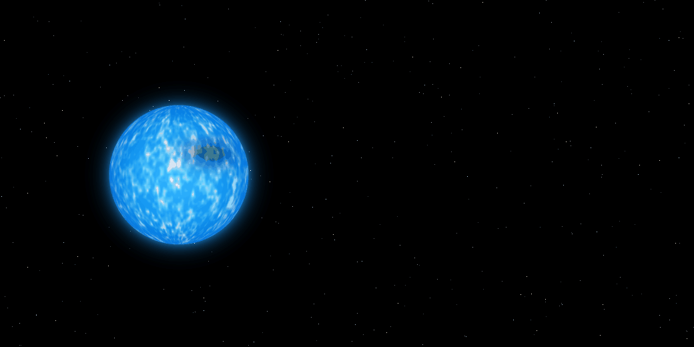
</p>

<p align="center"><i>The planet keeps circling a hot, blue-white star. Once each orbit it passes in front, and the brightness falls in a smooth dip, drawn deeper than a real transit so the shape is easy to see. The points are one measurement of that pass. These frames are drawn for this repository.</i></p>

<p align="center">
  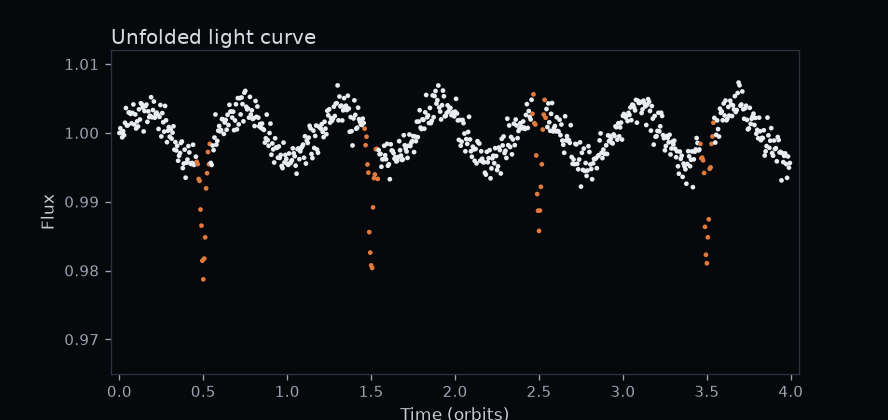
</p>

<p align="center"><i>Phase folding stacks every orbit on top of the next one. The transit, in orange, lands on the same phase. The motion follows the sketch in Shallue &amp; Vanderburg's Astronet repository. These frames are drawn for this repository.</i></p>

## What one example looks like

Kepler examples are two binned views of a phase-folded light curve. The **global view** has **2001** bins and covers the whole orbit. The **local view** has **201** bins and covers four transit durations on either side of the mid-transit. TESS examples are shorter, because a sector is about 27 days rather than four years: global **201**, local **61**, plus a **secondary view** of 61 bins centered on the strongest out-of-transit dip, and one scalar, the **depth change** between two apertures.

<p align="center">
  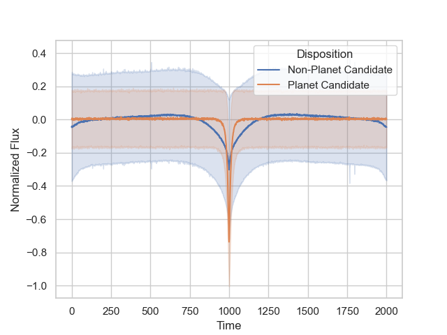
  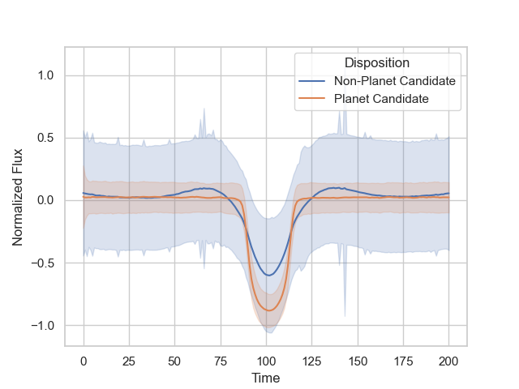
</p>

<p align="center"><i>Mean Kepler global and local views. Planet candidates are orange. Non-planet candidates are blue. The band is the standard deviation.</i></p>

<p align="center">
  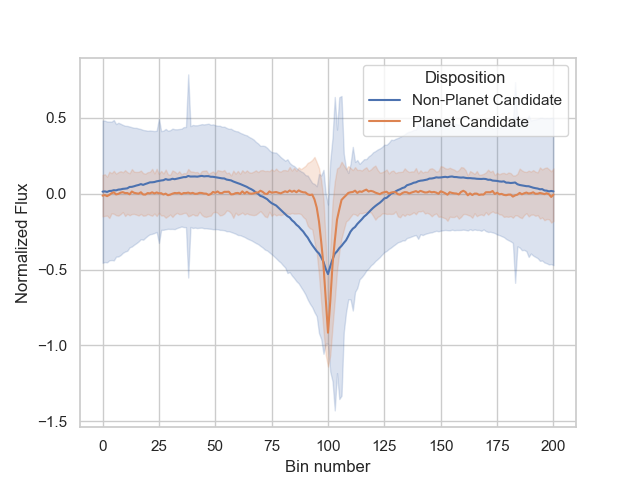
  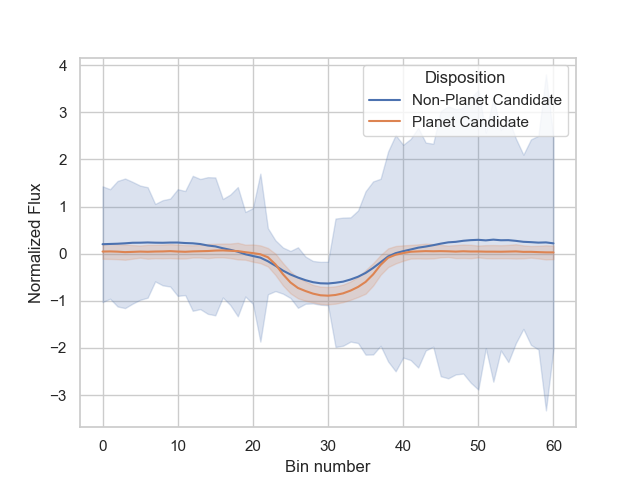
  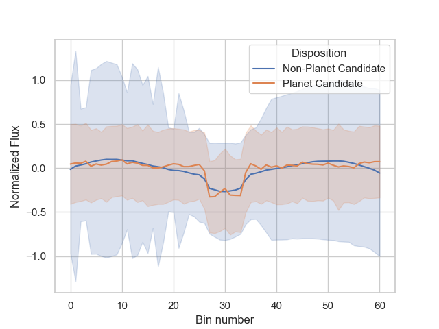
</p>

<p align="center"><i>The same comparison for the three TESS views.</i></p>

<p align="center">
  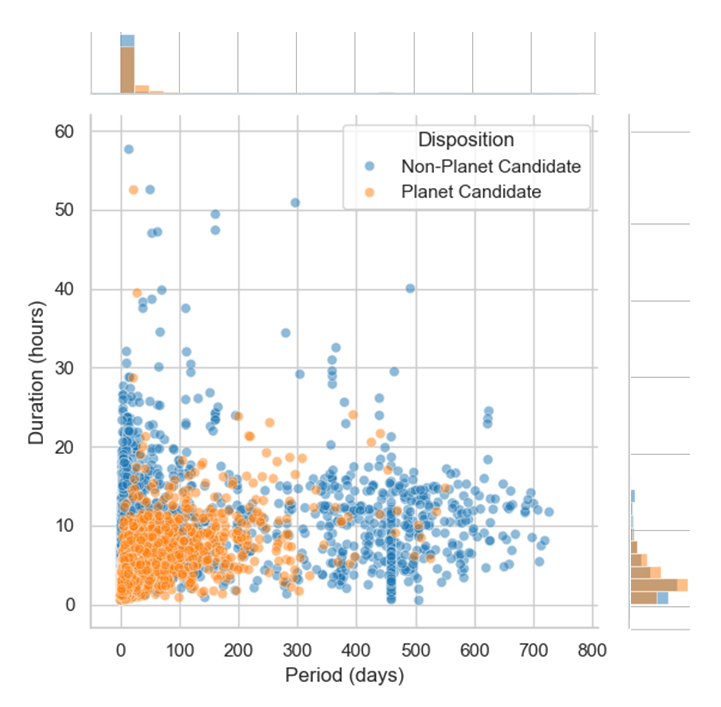
  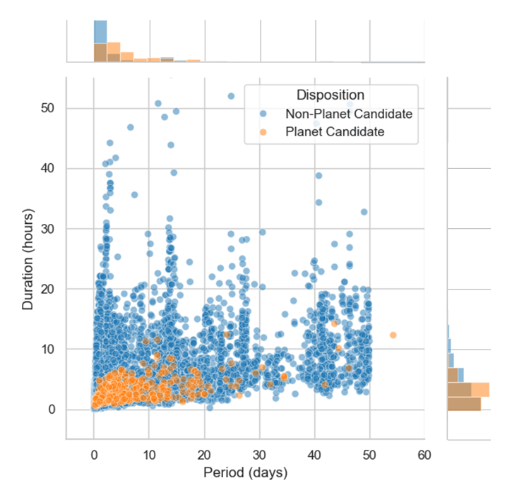
</p>

<p align="center"><i>Orbital period against transit duration. The two classes overlap, so the shape of the light curve has to do the work. Kepler is on the left, TESS on the right.</i></p>

Labels for Kepler come from the Autovetter catalog for Q1–Q17 Data Release 24. Planet Candidate is the positive class. Astrophysical False Positive and Non-Transiting Phenomenon are negative. Unknown rows are dropped: **15,737** TCEs, **3,600** of them positive. TESS labels are the visual dispositions of Yu et al. for sectors 1–5: **493** planet candidates against eclipsing binaries, instrumental noise, variability, and junk, **14,480** TCEs after the cuts in the paper.

The split is 80% train, 10% validation, 10% test. Kepler is a shuffle with seed 0: **12,589 / 1,573 / 1,575** rows and **2,906 / 328 / 366** positives. TESS is the split already stored with the examples: **11,573 / 1,465 / 1,442** rows and **349 / 57 / 48** positives.

How the views were built from the spacecraft light curves is Section 3 of the paper. The raw files stay at MAST:

- Autovetter Q1–Q17 DR24, [10.26133/NEA15](https://doi.org/10.26133/NEA15)
- Kepler light curves, [10.17909/T9488N](https://doi.org/10.17909/T9488N)
- TESS QLP high-level science products, [10.17909/t9-r086-e880](https://doi.org/10.17909/t9-r086-e880)
- TESS 2-minute light curves, [10.17909/t9-nmc8-f686](https://doi.org/10.17909/t9-nmc8-f686)

## The networks

Each view goes through its own column. Two convolutions (kernel 10, 128 filters, ReLU) shorten the sequence, then an LSTM stack reads it. Global stacks are **500, 200, 100** units. Local and secondary stacks are **200, 100, 50**. Additive attention replaces the last LSTM state with a weighted sum of every state. The weights are

`score_j = v tanh(b_j + W h_j)`,

with one attention unit, then a softmax over time. The columns are concatenated, passed through three feed-forward layers of 150 ReLU units, and a sigmoid. On TESS the depth change joins that concatenation. The loss is binary cross-entropy. Adam uses β1 = 0.9, β2 = 0.999, and ε = 1e-8, which is the value in the training scripts. The paper text quotes the library default, 1e-7.

<p align="center">
  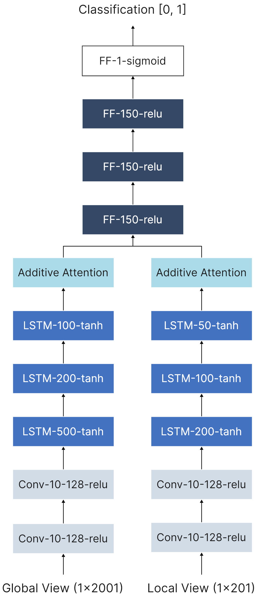
  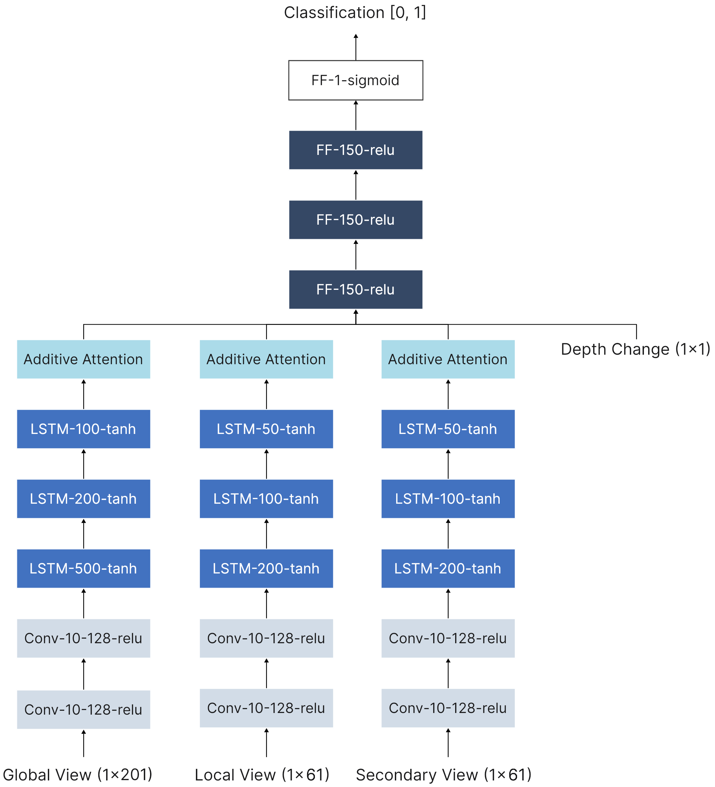
</p>

<p align="center"><i>Published architecture. Kepler on the left, TESS on the right. Attention adds 2,320 parameters on Kepler and 475 on TESS.</i></p>

Five networks are trained from scratch on both missions. The first two read the views concatenated into one sequence. The last three use the columns above. Reported metrics are the mean and standard deviation of **10** random initializations. The decision threshold is 0.5.

| Model | Kepler schedule | TESS schedule | Parameters, Kepler | Parameters, TESS |
| --- | --- | --- | ---: | ---: |
| Baseline, one LSTM unit | 150 epochs, 1e-4, batch 16 | same | 14 | 14 |
| Baseline + attention | same | same | 2,219 | 341 |
| Optimized, no attention | 25 epochs at 1e-4, then 25 at 1e-5, batch 64 | 20 epochs, 1e-4, batch 64 | 2,751,853 | 3,338,679 |
| **Optimized + attention** | same | same | **2,754,173** | **3,339,154** |
| Astronet / Astronet-Vetting | 50 epochs, 1e-5, batch 64 | 51 epochs, 1e-5, batch 64 | 8,793,313 | 2,216,593 |

Astronet is the convolutional network of Shallue & Vanderburg. Astronet-Vetting is the TESS network of Yu et al., including the secondary view and the depth change. Both are reimplemented in Keras here.

## What the study found

On Kepler, attention is what makes the one-unit LSTM useful: AUC goes from **0.4988** to **0.9009**. The column model is already strong, and attention still raises every reported metric. It uses about a third of Astronet's parameters.

On TESS the one-unit network never leaves the majority class, but its AUC rises from **0.4557** to **0.8981** once attention is added. The published column model is the most sensitive of the five and has the highest AUC. Astronet-Vetting is slightly more accurate and slightly more specific. TESS has **48** planet candidates in the test set, so the sensitivity of one run moves a lot.

<table align="center">
  <thead>
    <tr>
      <th>Data set</th>
      <th>Model</th>
      <th align="right">Accuracy</th>
      <th align="right">Sensitivity</th>
      <th align="right">Specificity</th>
      <th align="right">AUC</th>
    </tr>
  </thead>
  <tbody>
    <tr><td rowspan="5">Kepler</td><td>Baseline</td><td align="right">0.7676 ± 0.000</td><td align="right">0.0000 ± 0.000</td><td align="right">1.0000 ± 0.000</td><td align="right">0.4988 ± 0.115</td></tr>
    <tr><td>Baseline + attention</td><td align="right">0.8584 ± 0.006</td><td align="right">0.7350 ± 0.043</td><td align="right">0.8958 ± 0.009</td><td align="right">0.9009 ± 0.012</td></tr>
    <tr><td>Optimized</td><td align="right">0.9365 ± 0.003</td><td align="right">0.9016 ± 0.032</td><td align="right">0.9471 ± 0.007</td><td align="right">0.9758 ± 0.008</td></tr>
    <tr><td><b>Optimized + attention</b></td><td align="right"><b>0.9556 ± 0.003</b></td><td align="right"><b>0.9126 ± 0.027</b></td><td align="right"><b>0.9686 ± 0.007</b></td><td align="right"><b>0.9852 ± 0.007</b></td></tr>
    <tr><td>Astronet</td><td align="right">0.9486 ± 0.003</td><td align="right">0.8989 ± 0.034</td><td align="right">0.9636 ± 0.007</td><td align="right">0.9841 ± 0.008</td></tr>
    <tr><td rowspan="5">TESS</td><td>Baseline</td><td align="right">0.9667 ± 0.000</td><td align="right">0.0000 ± 0.000</td><td align="right">1.0000 ± 0.000</td><td align="right">0.4557 ± 0.131</td></tr>
    <tr><td>Baseline + attention</td><td align="right">0.9667 ± 0.000</td><td align="right">0.0000 ± 0.000</td><td align="right">1.0000 ± 0.000</td><td align="right">0.8981 ± 0.092</td></tr>
    <tr><td>Optimized</td><td align="right">0.9743 ± 0.004</td><td align="right">0.3750 ± 0.151</td><td align="right">0.9950 ± 0.007</td><td align="right">0.9705 ± 0.050</td></tr>
    <tr><td><b>Optimized + attention</b></td><td align="right">0.9785 ± 0.004</td><td align="right"><b>0.5208 ± 0.104</b></td><td align="right">0.9943 ± 0.007</td><td align="right"><b>0.9720 ± 0.045</b></td></tr>
    <tr><td>Astronet-Vetting</td><td align="right"><b>0.9792 ± 0.004</b></td><td align="right">0.4792 ± 0.129</td><td align="right"><b>0.9964 ± 0.006</b></td><td align="right">0.9645 ± 0.050</td></tr>
  </tbody>
</table>

<p align="center"><i>Test metrics. Each cell is the mean and standard deviation across the ten initializations.</i></p>

Attention on the published Kepler model sits on the transit. The peak is shifted a little toward egress: each convolutional step stands for itself and the 18 bins that follow it, and the LSTM then reads that sequence.

<p align="center">
  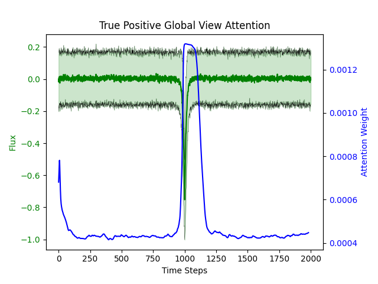
  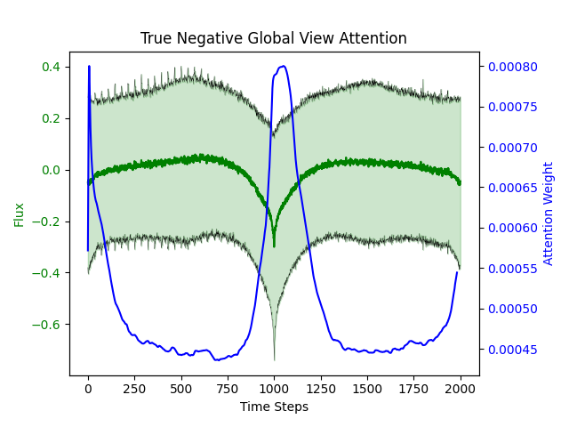
</p>

<p align="center"><i>Kepler global view, optimized + attention. True positives on the left, true negatives on the right. Blue is the mean attention weight. Green is the mean flux.</i></p>

<p align="center">
  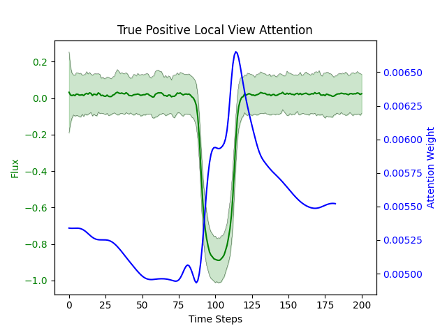
  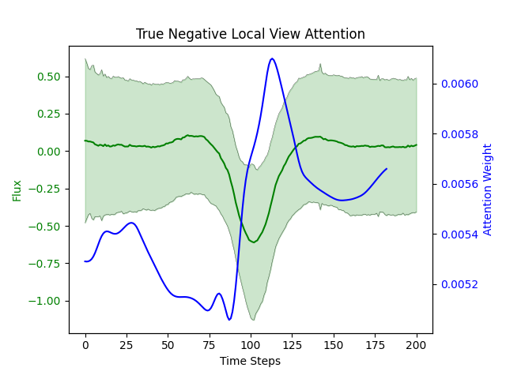
</p>

<p align="center"><i>Kepler local view for the same two groups. The weight stays high through the transit and after it.</i></p>

<p align="center">
  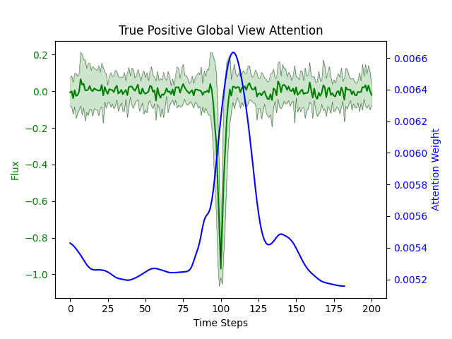
</p>

<p align="center"><i>TESS global view, true positives. The same transit-centered pattern shows up on the shorter sector light curves.</i></p>

## Run the code

Python 3.10, 3.11, or 3.12. TensorFlow does not publish a 3.14 wheel, which is why 3.14 is left out.

```bash
python -m venv .venv
source .venv/bin/activate          # Windows: .venv\Scripts\activate
python -m pip install -e ".[dev]"
pytest
python -m exoplanet_vetting
```

The bare command is a smoke run: 48 synthetic Kepler curves, the one-unit LSTM, one epoch. It does not read `data/` and its metrics are not the table above.

```bash
python -m exoplanet_vetting --paper --dataset kepler
python -m exoplanet_vetting --paper --dataset tess --model astronet --ensemble 1
```

`--paper` loads `data/`, selects **optimized + attention**, the published schedule, and an ensemble of 10. Seeds are 0 through 9. On the GTX 1650 Ti used for the paper, one Kepler epoch of that model took about 79 seconds and one TESS epoch about 42 seconds, so the ensemble is a long run. TensorFlow wheels for native Windows do not use a GPU. The same run is faster under WSL2 or Linux, where the GPU build is available. `--epochs` replaces a two-stage schedule with a single learning rate, and the console says so.

```text
python -m exoplanet_vetting --paper --dataset kepler --model baseline --epochs 2 --ensemble 1
```

Metrics are written to `outputs/metrics.txt`. The mean and standard deviation match the table. The line labeled "mean probability" is the average of the ten sigmoid outputs, which is what the paper uses when it groups true positives, false positives, true negatives, and false negatives.

From Python:

```python
from exoplanet_vetting.data import load_dataset, model_inputs
from exoplanet_vetting.models import build_model

cohort = load_dataset("kepler", "data")
x_train, y_train = model_inputs(cohort, cohort.train_idx, "optimized-attention")
model = build_model("kepler", "optimized-attention", 1e-4, {"global": 2001, "local": 201})
```

```text
src/exoplanet_vetting/
  config.py      published schedules, lengths, and parameter counts
  data.py        shards, frozen indices, and the arrays each model expects
  synthetic.py   the smoke cohort
  attention.py   additive attention with one unit
  models.py      the five networks
  metrics.py     accuracy, sensitivity, specificity, precision, F1, AUC
  training.py    a schedule and an ensemble
  console.py     section titles and the progress bar
  plots.py       the phase-folding animation
  run.py         the command line
```

## Data

`data/kepler/part-00.npz` and `part-01.npz` are the binned Kepler views. `data/tess/views.npz` is the binned TESS views. Both are float32. Training reads these files. It does not download spacecraft images, and this repository does not include the code that built the bins.

Kepler arrays, one row per TCE, split across the two shards and concatenated in order:

| Array | Shape | What it is |
| --- | --- | --- |
| `global_view` | (15737, 2001) | Normalized whole-orbit view |
| `local_view` | (15737, 201) | Normalized transit view |
| `label` | (15737,) | 1 planet candidate, 0 otherwise |
| `period_days` | (15737,) | `tce_period` |
| `duration_hours` | (15737,) | `tce_duration` |
| `transit_depth` | (15737,) | `tce_depth`, ppm |
| `tce_id` | (15737,) | `kepid-planet` |
| `train_idx`, `val_idx`, `test_idx` | stored in `part-00.npz` | Row numbers in the concatenated table |

TESS arrays, train then validation then test:

| Array | Shape | What it is |
| --- | --- | --- |
| `global_view` | (14480, 201) | Normalized whole-orbit view |
| `local_view` | (14480, 61) | Normalized transit view |
| `secondary_view` | (14480, 61) | Normalized secondary-eclipse view |
| `depth_change` | (14480,) | Aperture depth change, already standardized |
| `label` | (14480,) | 1 planet candidate, 0 otherwise |
| `split` | (14480,) | 0 train, 1 validation, 2 test |

`scripts/export_views.py` is the one-time conversion from the study pickles. It checks the row counts, the view lengths, and the Kepler positive counts before it writes.

## Citation

```bibtex
@article{hernandez2025additive,
  author  = {Hern{\'a}ndez-Carnerero, {\`A}lvar and S{\`a}nchez-Marr{\`e}, Miquel and Morales, Juan Carlos},
  title   = {Additive Attention for Vetting Transiting Exoplanet Candidates},
  journal = {The Astronomical Journal},
  year    = {2025},
  doi     = {10.3847/1538-3881/add2f1},
  url     = {https://doi.org/10.3847/1538-3881/add2f1}
}
```

The architecture diagrams, the mean light curves, the scatter plots, and the attention panels are the figures from the article. The transit animation and the phase-folding animation were made for this repository. The software is released under the MIT license. The article remains with the publisher.
